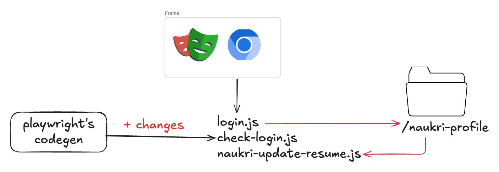

# Naukri.com Resume Updater

Automatically refresh your Naukri.com resume with a script. It uses [Playwright](https://playwright.dev) to log in once (manually), save your session locally, and then re-upload your resume whenever you run it, so your profile stays fresh for recruiters.

## Architecture



## Features

- One-time manual login, with the session saved **locally**
- One-command resume update
- Playwright test to verify the update went through
- Session data is gitignored, so you won't accidentally push credentials

## Prerequisites

- [Node.js](https://nodejs.org) 18 or newer
- A Naukri account
- Your resume file (PDF/DOC/DOCX), supported by naukri.com, available locally

## Setup

### 1. Clone the repo

```bash
git clone <your-repo-url>
cd <project-directory>
```

### 2. Configure environment variables

Create a `.env` file in the project root and add:

```env
RESUME_PATH=/absolute/path/to/your/resume.pdf
NAUKRI_PROFILE_URL= naukri profile url
```

| Variable             | Description                                         |
| -------------------- | --------------------------------------------------- |
| `RESUME_PATH`        | Absolute path to the resume file you want to upload |
| `NAUKRI_PROFILE_URL` | URL of your Naukri profile page                     |

### 3. Install dependencies

```bash
npm install
```

## Usage

### 4. Go to the project directory

```bash
cd <project-directory>
```

### 5. Log in

```bash
npm run login
```

A browser window opens. **Log in manually** to your Naukri account. Your session details are saved in the local `naukri-profile/` folder. You can close the window now.

> `naukri-profile/` is already in `.gitignore`, so you won't accidentally push your session to Git. Never commit or share this folder.

### 6. Verify the login

```bash
npm run verify-login
```

It should open your Naukri profile. If it does, you're logged in. Now close the window.

### 7. Update your resume

Once you're logged in, you don't need to repeat the steps above. For all future updates, just run

```bash
npm run update
```

This uploads the file at `RESUME_PATH` to your Naukri profile.

To keep the browser open for inspection after execution, run following instead:

```bash
npm run update:pause
```

### 8. Verify the update

```bash
npm run verify-update
```

The test confirms the resume was updated successfully.

### 9. Update and Verify together

For convenience, if you want to update and double check if today's date is shown in Resume section, you can run:

```bash
npm run update-and-verify
```

This updates your resume and then verifies it. If your session has expired, run `npm run login` again first.

## Troubleshooting

| Problem                                            | Fix                                                              |
| -------------------------------------------------- | ---------------------------------------------------------------- |
| `npm run verify-login` redirects to the login page | Session expired. Run `npm run login` again.                      |
| Resume file not found                              | Make sure `RESUME_PATH` is an absolute path and the file exists. |

## Security notes

- Keep `.env` and `naukri-profile/` out of version control.
- The saved session grants access to your Naukri account. Treat it like a password.

## Disclaimer

This project is for personal use and is not affiliated with Naukri / Info Edge. Automating a website may be restricted by its terms of service, so use it responsibly and at your own risk.
